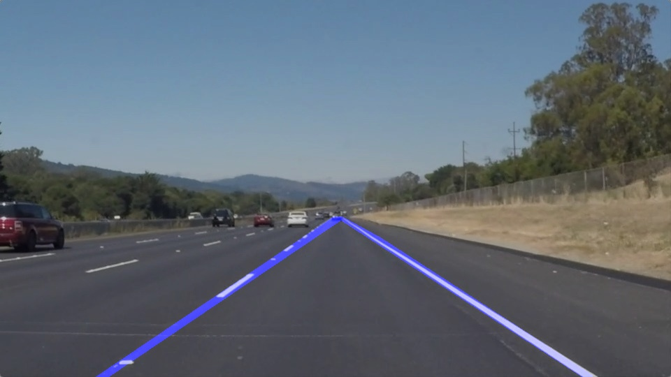
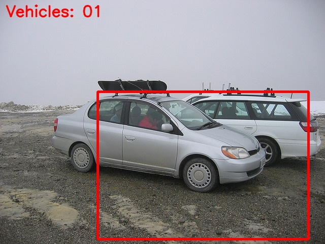
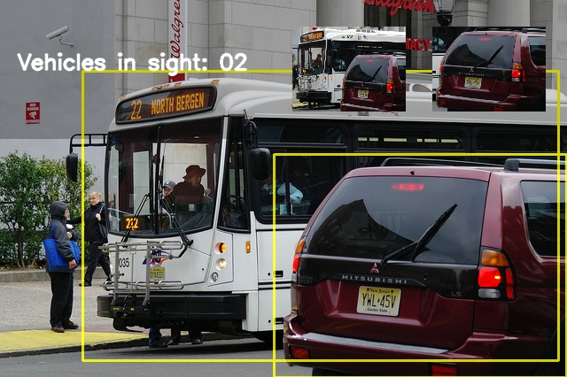
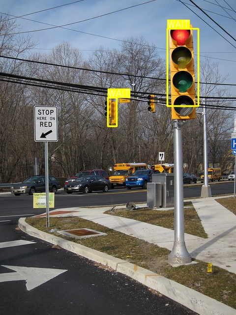

# Self-Driving Car — Perception Pipelines

[](https://github.com/Goutham011/Self-Driving_car/actions/workflows/ci.yml)

Four perception modules for an autonomous-driving stack, each runnable
end-to-end from the command line on CPU: lane detection, two vehicle
detectors (HOG+SVM and MobileNet-SSD), and traffic-light state detection
with optional spoken alerts.

| Lane detection | Vehicle detection (HOG + SVM) |
| --- | --- |
|  |  |

| Vehicle detection (MobileNet-SSD) | Traffic lights (YOLOv3-tiny) |
| --- | --- |
|  |  |

## Pipelines

| Module | Entry point | Method | Speed (CPU) |
| --- | --- | --- | --- |
| Lane lines | `main.py` | color + gradient thresholds → perspective transform → sliding-window polynomial fit, smoothed per line | ~5 FPS (960x540) |
| Vehicle detection | `main_hog1.py` | OpenCV HOG features + Linear SVM, multi-scale sliding windows, heatmap fusion with confidence filtering | ~1.5–2.5 FPS (CPU) |
| Vehicle detection | `main_ssd.py`, `process_video.py` | MobileNet-SSD (Caffe, VOC) with IoU-based dedup and live vehicle counter | ~10 FPS (500x374) |
| Traffic lights | `detect.py` | YOLOv3-tiny detects COCO "traffic light"; HSV analysis of the lamp decides STOP / WAIT / GO and speaks it via TTS | ~2.6 FPS (512px) |

## Quick start

```bash
git clone https://github.com/Goutham011/Self-Driving_car.git
cd Self-Driving_car
python3 -m venv .venv && source .venv/bin/activate
pip install -r requirements.txt
```

Model weights download automatically on first use (no manual setup):

- MobileNet-SSD `mobilenet_iter_73000.caffemodel` (~23 MB, chuanqi305/MobileNet-SSD)
- YOLOv3-tiny `yolov3-tiny.weights` (~34 MB, official pjreddie release)

Lane test images/video and traffic-light test images are committed under
`data/lane/` and `data/traffic_light/`.

## Usage

### Lane detection

```bash
python main.py --input data/lane/test_videos/solidWhiteRight.mp4
python main.py --input data/lane/test_images/solidYellowLeft.jpg --no-display
```

Outputs annotated frames/video to `out/lane/`. The `Line` class keeps a
rolling history of the last few fits so a single bad frame does not make the
lanes jump.

### Vehicle detection — HOG + SVM

Build the training set from COCO (vehicles vs. non-vehicles, with hard
negatives sampled from scenes that contain vehicles), train the classifier,
then run detection:

```bash
python download_dataset.py --num-vehicles 3000 --num-non-vehicles 3000
python train_svm.py --max-per-class 3000
python main_hog1.py --input data/lane/test_images
```

`train_svm.py` tunes the SVM regularization by 3-fold cross-validation,
reports held-out accuracy/precision/recall, and writes
`data/models/{svm_trained,feature_scaler,feat_extraction_params}.pickle`.
Train and inference share the exact same feature code path
(`functions_feat_extraction.image_to_features`, OpenCV HOG), so the models
cannot drift apart.

### Vehicle detection — MobileNet-SSD

```bash
python main_ssd.py --input data/ssd/images            # directory or single image
python process_video.py --input data/ssd/ssd_test_video.mp4
```

Detects VOC classes bus / car / motorbike, fuses near-duplicate boxes
(IoU ≥ 0.5), draws a live "Vehicles in sight" counter plus a thumbnail per
tracked vehicle, and reports how many raw detections were fused.

### Traffic lights (YOLOv3-tiny)

```bash
python detect.py --source data/traffic_light          # images, video, or webcam index
python detect.py --source 0                           # webcam
python detect.py --source data/traffic_light --no-tts # disable speech
```

For every detected traffic light the lamp color is classified in HSV space
into STOP (red), WAIT (yellow) or GO (green) and, unless `--no-tts` is set,
announced through text-to-speech.

## Tests

```bash
pytest
```

34 tests cover lane-line fitting, perspective/ROI logic, sliding-window
geometry, heatmap fusion (>255 hits, threshold semantics), HOG feature
extraction, box IoU/merging, and asset-backed smoke tests of every pipeline.

## Datasets & credits

- Training data for the HOG/SVM detector is built from the
  [COCO 2017](https://cocodataset.org) train/val splits via
  `download_dataset.py` (vehicle crops + clean and hard negatives).
- Lane test images/video: Udacity Self-Driving Car Nanodegree Project 1.
- MobileNet-SSD weights: [chuanqi305/MobileNet-SSD](https://github.com/chuanqi305/MobileNet-SSD)
  (trained on Pascal VOC).
- YOLOv3 inference code (`models.py`, `utils/`, `detect.py`) is vendored from
  [ultralytics/yolov3](https://github.com/ultralytics/yolov3)
  (commit `fa78fc4`, GPL-3.0) with modifications for traffic-light actions
  and TTS.

## License

GPL-3.0 (see [LICENSE](LICENSE)) — required by the vendored GPL-3.0
YOLOv3 inference code; original code in this repository is authored by
[Goutham](https://github.com/Goutham011).
